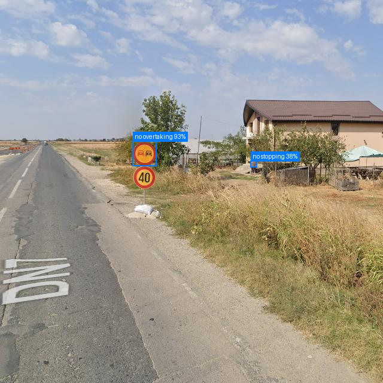

# Argus AI

**Live demo:** [ai-argus.netlify.app](https://ai-argus.netlify.app)

Upload a road photo and Argus finds vehicles, pedestrians, traffic lights and 16 kinds of traffic signs with a custom-trained YOLOv8s model, then applies spatial rules to flag likely violations (for example, a vehicle next to a no-entry sign).



> **Note:** the backend runs on a free Hugging Face Space (CPU) that sleeps when idle. The first request after a sleep takes about 30 seconds while it wakes up; after that a request takes about 3 seconds end to end.

## Results

YOLOv8s fine-tuned for 80 epochs (batch 16, 640 px) on a Colab GPU in 2.7 hours. Validation split, 1,470 images, 1,592 boxes:

| Metric | Value |
|---|---|
| mAP50 | 0.927 |
| mAP50-95 | 0.810 |
| Precision / Recall | 0.920 / 0.871 |
| Vehicles (car / truck / bus) mAP50 | 0.825 / 0.732 / 0.747 |
| Traffic signs mAP50 | 0.86 to 0.995 |

Inference: about 4 ms per image (model time) on an Apple M3 Pro GPU (MPS), about 87 ms on its CPU. The live demo runs on a free CPU Space, so expect about 3 seconds per request including the network round trip.

**Limitations.**
- The 5,254 training images merge three public sources (a traffic-sign image set, street-view sign frames and BDD100K crops), and 90% of them contain a single labeled object. Most are cropped images, not full dashcam frames.
- Signs are detected well. Vehicles are the weakest classes (truck 0.732, bus 0.747), and vehicles in full street scenes can be missed because one source dataset labels only signs.
- The validation split also chose the checkpoint, and there is no separate test set, so these numbers are likely a little optimistic.
- Violations come from distance rules on a single image, not from tracking over time, so they are hints, not evidence.

## How it works

1. The Next.js frontend posts the image to `POST /api/detect` on the FastAPI backend.
2. YOLOv8s detects 23 classes: 5 road users (person, car, truck, bus, motorcycle), 2 light states (red, green) and 16 sign types (stop, no entry, no overtaking, speed limits 20 to 120, no left turn, no right turn, no stopping, no U-turn).
3. A rule engine (`backend/services/violation_rules.py`) checks distances between detections: 8 sign rules, speed-zone notices and pedestrian proximity.
4. The API returns JSON detections, violations and an annotated image.

## Tech stack

- **Model:** YOLOv8s trained with ultralytics
- **Backend:** Python, FastAPI (inference, violation rules, image annotation)
- **Frontend:** Next.js 16, TypeScript, Tailwind CSS
- **Deployment:** backend as a Docker container on Hugging Face Spaces (CPU basic), frontend on Netlify (`netlify.toml` sets `NEXT_PUBLIC_API_URL`)

## Run locally

Requires Python 3.10+ and Node.js 18+. Download `best.pt` from the [v1.0-model release](https://github.com/pratyushpad/Argus-AI/releases/tag/v1.0-model) to `model/best.pt` (the Docker setup needs it too), then:

```bash
python3 -m venv .venv && source .venv/bin/activate
pip install -r backend/requirements.txt
cd backend && python main.py          # http://localhost:8080/docs
```

```bash
cd frontend && npm install && npm run dev   # http://localhost:3000
```

Or `docker compose up --build`.

## Train

```bash
pip install ultralytics
python model/train.py --data model/data.yaml --epochs 80 --batch 16
```

Set `path:` in `model/data.yaml` to your dataset folder (YOLO format: `images/` and `labels/`, each with `train/` and `val/`). The dataset is not included in this repo. Best weights land in `runs/traffic_violation/weights/best.pt`; copy that to `model/best.pt`.

## Project structure

```
├── model/            # Training script and data config
├── backend/          # FastAPI app (detection, violation rules, annotator)
├── frontend/         # Next.js app (upload UI, results display)
├── docs/             # README images
└── docker-compose.yml
```

## What I learned

- Training YOLOv8 on a custom dataset with mixed image sizes and 23 classes
- Why one headline mAP hides weak classes, and why a merged dataset needs per-source checks
- Building spatial proximity rules to infer violations from static image detections
- Containerizing a FastAPI model server and deploying it on Hugging Face Spaces
